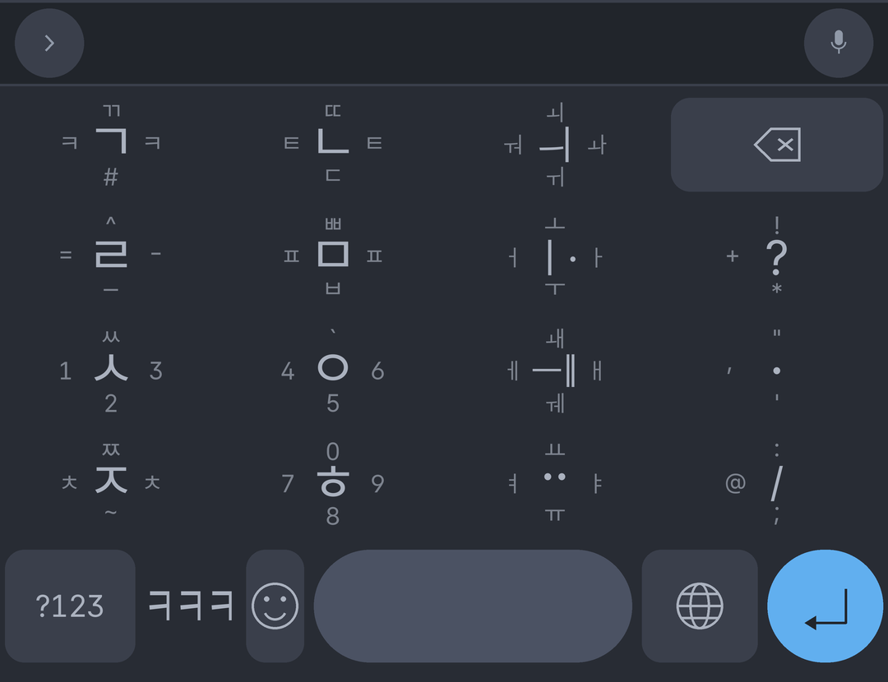
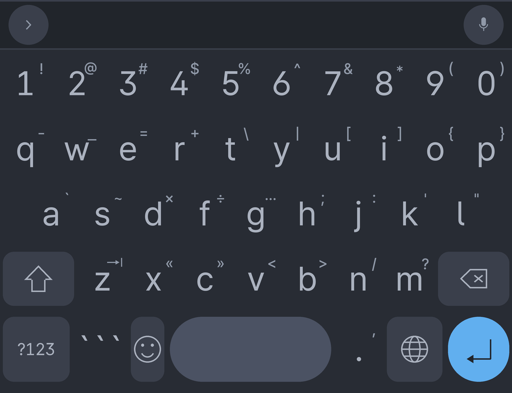
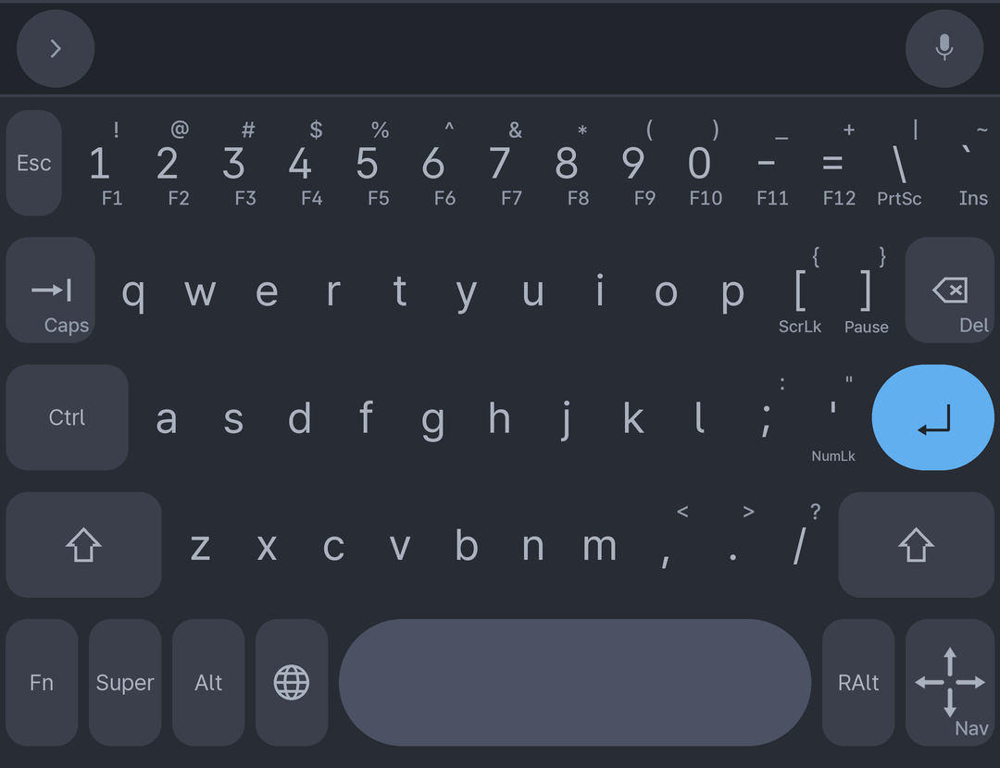
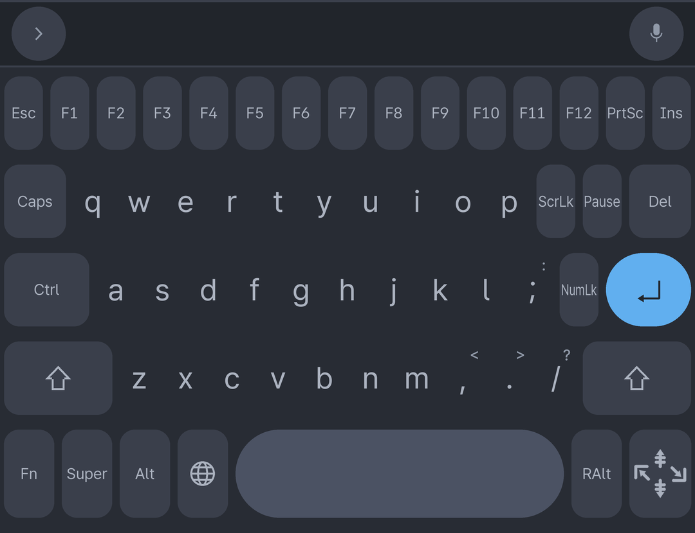

# nesswit-futo-layout

개인적으로 쓰는 [FUTO Keyboard](https://keyboard.futo.org/) 커스텀 레이아웃 저장소.
레이아웃 정의(yaml)와, 딩굴 플릭 힌트를 키 위에 그려 주는 커스텀 테마 빌더가 들어 있다.

| 파일 | 내용 |
|---|---|
| `dingul.yml` | 딩굴 방식 한글 플릭 레이아웃 |
| `qwerty_hacker.yml` | 기호를 손보고 숫자 줄을 뺀 QWERTY |
| `qwerty_kbd75.yml` | Android 터미널(AVF)의 Linux 화면용 KBD75 배열. Ctrl/Alt/Super 키와 Fn 레이어가 있다 |
| `tools/build_theme.py` | 딩굴 플릭 힌트(와 KBD75 시프트 문자)를 키에 구워 넣는 테마 빌더 ([THEME.md](THEME.md)) |

---

## 레이아웃 추가

FUTO Keyboard 개발자 설정의 레이아웃 에디터에서 yaml 내용을 붙여넣어 추가한다.
추가한 **순서대로** 내부 이름이 `custom0`, `custom1`, … 로 정해지며
(`DevLayoutEditor.kt:95`), 테마 선택자가 이 이름을 쓰므로 순서를 바꿨다면 테마를
다시 빌드해야 한다. 자세한 건 [THEME.md](THEME.md#레이아웃-이름-custom0--custom1--) 참고.

레이아웃 문법은 앱 저장소의 `java/assets/layouts/LayoutSpec.md` 에 정리되어 있다.

---

## 딩굴 (`dingul.yml`)

키를 누른 채 상/하/좌/우로 밀어(flick) 문자를 입력하는 4열 한글 레이아웃.
원본 딩굴과 달리 **ㅒ / ㅖ 는 ㅐ / ㅔ 를 두 번 입력**해서 넣는다 (`ㅇ+ㅐ+ㅐ = 얘`).



아래 테마 빌더가 만드는 미리보기 렌더(`build/preview.png`)다. 가운데 큰 글자가 기본 입력,
주변 넷이 방향별 입력이며, 테마를 설치하면 실제 키보드에도 이대로 힌트가 보인다.

- 자음 키의 좌/우는 같은 문자다(ㅋ, ㅌ, ㅍ, ㅊ). 어느 쪽으로 밀어도 된다.
- 3열은 모음 전용이다. `ㅣ·` `ㅡ‖` `··` 는 천지인처럼 획을 더하는 용도.
- 숫자는 ㅅ / ㅇ / ㅎ 키의 방향 입력에 흩어져 있다.
- 아래 줄은 `?123` · `ㅋㅋㅋ` · 액션 · 스페이스 · 컨텍스트 키 · 엔터.

`showPopup: false`, `moreKeyMode: OnlyExplicit` 이라 롱프레스 팝업은 뜨지 않는다.

---

## QWERTY (`qwerty_hacker.yml`)



별도 숫자 행을 켜는 대신(`numberRowMode: AlwaysDisabled`) 첫 줄에 숫자를 직접 두고,
각 키의 롱프레스에 기호를 몰아넣은 영문 레이아웃. 키 우상단의 작은 글자가 롱프레스로
나오는 문자다.

- 괄호·연산자는 `qwerty` 줄, 따옴표류와 `;` `:` 는 `asdf` 줄에 있다.
- `z` 롱프레스는 탭, `x` `c` 는 `«` `»`, `v` `b` 는 `<` `>` 다.
- 아래 줄에 코드 블록용 ` ``` ` 키를 두었다.

---

## KBD75 (`qwerty_kbd75.yml`)





Android 터미널 앱(AVF)의 Linux 화면에서 Ctrl+W 같은 단축키를 쓰려고 만든, KBD75 배열을
본뜬 영문 레이아웃. 위가 기본 페이지, 아래가 Fn 을 누른 페이지다.

이 레이아웃은 공식 FUTO Keyboard 로는 제대로 동작하지 않는다.
[rishubil/android-keyboard](https://github.com/rishubil/android-keyboard) 의
`feat/avf-soft-key-passthrough` 가 들어간 빌드(`0.1.30-nesswit`)가 필요하고, 설정 > Typing 의
"Send soft keys as hardware keys to the Linux terminal" 옵션을 켜야 한다. 그 코드(`!code/keyevent_*`,
`!code/key_cursor_pad`, `!code/key_nav_pad`)를 모르는 빌드에서도 레이아웃은 깨지지 않지만,
해당 키는 눌러도 아무것도 하지 않는다.

- 숫자 줄 위의 F 줄은 없다. Fn 을 누른 뒤 숫자 줄을 누르면 F1-F12 다.
- Ctrl, Alt, Super 는 한 번 탭하면 다음 키 하나에만 걸리고(래치), 빠르게 두 번 탭하면 잠긴다.
  잠긴 키는 다시 탭하면 풀린다. 누른 채로 다른 키를 눌러도 조합이 나간다.
- Fn 은 다음 키 하나를 누르면 기본 페이지로 돌아온다. Ctrl 같은 수정키는 이 "다음 키"로 치지 않는다.
- 오른쪽 아래 화살표 키를 상/하/좌/우로 끌면 방향키가 나간다. Fn 페이지에서는 같은 동작이
  Home / End / PgUp / PgDn 이다.
- 키 우상단은 Shift 문자, 우하단은 Fn 기능이다. 이 힌트는 레이아웃이 아니라 아래 테마가
  그린다(`--kbd75-layout`).

터미널 앱의 빌드에 따라서는 키보드 앱이 보낸 Ctrl, Alt, Super, F 키, Home/End, PgUp/PgDn, Ins, Del 을
게스트에 넘기지 않는다. Galaxy Tab S11 의 `VmTerminalApp@BP4A.251205.006` 이 그렇다. 이 빌드에서
게스트에 닿는 키는 글자, 숫자, 기호, Shift, Esc, Tab, Enter, Backspace, 방향키뿐이다. Ctrl 조합은
터미널 앱이 화면에 띄우는 패널의 Ctrl 을 누른 채로 이 레이아웃의 글자를 누르면 된다.

---

## 딩굴 플릭 힌트 테마

앱은 어느 방향에 무슨 글자가 있는지 표시해 주지 않는다. `tools/build_theme.py` 는
`dingul.yml` 을 읽어 방향 문자를 그려 넣은 키 아이콘을 만들고, 그걸 묶어 임포트할 수
있는 커스텀 테마 zip 을 만든다.

```
uv run tools/build_theme.py --layout custom0
```

[uv script](https://docs.astral.sh/uv/guides/scripts/) 라 `uv` 만 있으면 되고, 결과물은
`dist/i.nesswit.DingulFlick.zip` 이다. 설치 절차, 앱 코드 조사 결과, 조정할 수 있는 값은
전부 [THEME.md](THEME.md) 에 있다.

테마는 모든 레이아웃의 기능키(Esc, Ctrl, Shift, Backspace …)에 배경을 깐다. 수정키의 래치·잠김
표시는 앱 기본 그대로 보인다 ([THEME.md](THEME.md#기능키-배경)).

`qwerty_kbd75.yml` 도 쓴다면 `--kbd75-layout custom0` 처럼 그 레이아웃 번호를 주면, 같은 테마에
키마다 시프트 문자(우상단)와 Fn 기능(우하단)을 표시하는 오버레이도 들어간다. 이때 KBD75 미리보기
`build/preview_kbd75.png` 와 `build/preview_kbd75_fn.png` 도 같이 만든다. 자세한 건
[THEME.md](THEME.md#kbd75-시프트-문자와-fn-기능-qwerty_kbd75yml) 참고.

**`dingul.yml` 을 고쳤다면 테마를 다시 빌드해야 한다.** 자동 동기화되지 않아서
표시와 실제 입력이 어긋날 수 있다.

빌드 산출물은 gitignore 대상이다. 위에 띄운 미리보기 네 장(`build/preview.png`,
`build/preview_qwerty.png`, `build/preview_kbd75.png`, `build/preview_kbd75_fn.png`)만 예외로
커밋하고, `preview_states.png` 는 커밋하지 않는다. 미리보기는 테마를 설치했을 때 기기 화면에 가깝게 그리므로,
`qwerty_hacker.yml` 을 고쳤을 때도 다시 빌드하면 쿼티 미리보기가 갱신된다.
